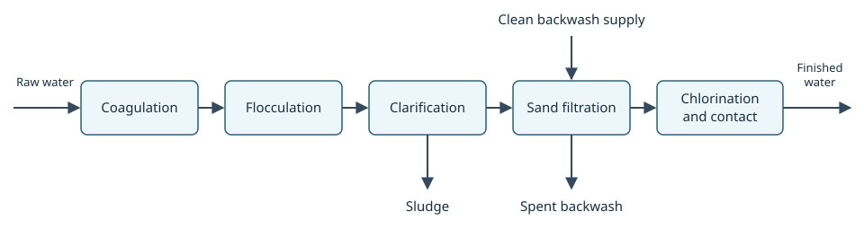

# Model a treatment train

This tutorial models a conventional surface-water treatment train:
coagulation, flocculation, sedimentation, filtration, and disinfection
([CDC overview](https://www.cdc.gov/drinking-water/about/how-water-treatment-works.html)).
You will connect the stages, mark the system boundary, explore the result,
save it, and load it again.



The model records equipment, connectivity, and treatment intent. It does not
calculate removal, dose, or contact time.

## 1. Import the stages

`objectrdf.watr.drinking_water` provides one class per stage. Each subclasses
a WaTr equipment class and fixes its process, objective, and named ports.

| Stage | Class | WaTr parent |
| --- | --- | --- |
| Coagulation | `CoagulationStage` | `CoagulationBasin` |
| Flocculation | `FlocculationStage` | `FlocculationBasin` |
| Clarification | `ClarificationStage` | `SedimentationTank` |
| Filtration | `RapidSandFiltrationStage` | `RapidSandFilter` |
| Disinfection | `ChlorinationStage` | `ChlorinationUnit` |

```{code-cell} python3
from objectrdf import Model, connect
from objectrdf.watr import SedimentationTank
from objectrdf.watr.drinking_water import (
    ChlorinationStage,
    ClarificationStage,
    CoagulationStage,
    FlocculationStage,
    RapidSandFiltrationStage,
)
```

## 2. Connect the stages

Connect named ports along the production path. The clarifier's `sludge`
outlet and the filter's backwash ports are separate points, so waste cannot
end up feeding the next stage.

```{code-cell} python3
with Model("urn:example/treatment#") as model:
    with model.system("treatment-system") as system:
        coagulation = CoagulationStage("coagulation")
        flocculation = FlocculationStage("flocculation")
        clarifier = ClarificationStage("clarifier")
        sand_filter = RapidSandFiltrationStage("sand-filter")
        disinfection = ChlorinationStage("chlorination-contact")

        connect(coagulation.outlet, flocculation.inlet, name="coagulated-water")
        connect(flocculation.outlet, clarifier.inlet, name="flocculated-water")
        connect(
            clarifier.clarified_water, sand_filter.inlet, name="clarified-water"
        )
        connect(
            sand_filter.filtered_water, disinfection.inlet, name="filtered-water"
        )

        system.boundary(
            coagulation.inlet,
            disinfection.outlet,
            clarifier.sludge,
            sand_filter.backwash_supply,
            sand_filter.backwash_waste,
        )
```

`model.system()` groups the stages. `boundary()` marks the points where flow
crosses into or out of the system: raw water in, finished water out, sludge
out, and backwash water in and out.

## 3. Explore the result

`compile()` resolves the connections, validates the model, and returns a
snapshot:

```{code-cell} python3
resolved = model.compile()
```

Look up the clarifier and list its process and objective:

```{code-cell} python3
resolved_clarifier = resolved["clarifier"]

for process in resolved_clarifier.has_process:
    print("process:", process.meta.label)

for objective in resolved_clarifier.has_treatment_objective:
    print("objective:", objective.meta.label)
```

Look up a pipe by its name and see which points it joins:

```{code-cell} python3
pipe = resolved["clarified-water"]
print(pipe.type, pipe.medium)
for point in pipe.connects_at:
    print(point.owner.name, point.label)
```

List the points where flow crosses the system boundary:

```{code-cell} python3
plant = resolved["treatment-system"]
for point in plant.has_boundary_connection_point:
    print(point.owner.name, point.label, point.type, point.medium)
```

Sludge is its own medium. Both filter outlets carry water and are told apart
by name.

## 4. Save and load

```{code-cell} python3
model.save("treatment.ttl")
```

The file imports the drinking-water ontology, so `from_graph()` selects the
right package. Query by the WaTr parent class:

```{code-cell} python3
loaded = Model.from_graph("treatment.ttl")
loaded.find_all(SedimentationTank)
```

The clarifier was saved as a `ClarificationStage`, which is a kind of
`SedimentationTank`.

## 5. Draw it

```{code-cell} python3
from objectrdf import flowsheet

flowsheet(loaded, title="Conventional treatment train")
```

Unconnected boundary points are drawn as feed and product terminals.

## Next

[Instrument a plant](watr-instrumented-plant.md) adds pumps, residuals
handling, an influent property set, sensors, and actuators to this train. The
script version is `examples/watr/treatment/watr_quickstart.py`.
