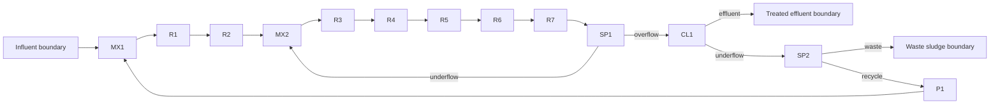

# WaterTAP ASM2d as WaTr/S223 RDF

Run from the repository root:

```bash
uv run python examples/watr/asm2d/watertap_asm2d.py
```

The script writes `asm2d.ttl` beside itself. It describes
[WaterTAP's ASM2d flowsheet](https://watertap.readthedocs.io/en/stable/technical_reference/flowsheets/ASM2d.html):



The model has 13 members, 14 internal connections, and three system boundary
points. The internal connection names retain WaterTAP's stream numbers. Feed,
treated effluent, and waste sludge are boundary points. R1–R2 are anaerobic,
R3–R4 are anoxic, and R5–R7 are aerobic.

Equipment configurations and property schemas are generated from
[ontology/asm2d.ttl](../../../ontology/asm2d.ttl). Imports such as `AerobicStage`
already carry their processes, objectives, roles, and named ports, so the script
defines no supporting Python of its own. `model.system(...)`
collects equipment and junctions; `system.boundary(...)` marks its boundaries.

`ASM2dState` groups the 22 feed quantities. Its descriptive Python keywords
retain the familiar S/X symbols as RDF `skos:notation`: S means soluble and X
means particulate. Each component identifies its exact pool through
`ofSubstance` and its water medium through `ofMedium`. The constituent terms are
compiled into WaTr from [asm2d-components.ttl](../../../ontology/asm2d-components.ttl).
Alkalinity describes water and has no separate substance qualification.

`ReactorDesign`, `AerobicDesign`, and `OxygenOutletState` are immutable value
schemas. `apply_properties(...)` creates independent properties on the target.
Bare numbers use shape-declared units; `QuantityAmount` (imported as `Q`) carries
an explicit compatible unit. `AerobicDesign` supplies the shape's default volume
of 1333 m³. Call `AerobicDesign.describe()` to inspect units, defaults, and source
shapes.

The three aerobic outlet oxygen values are 1.91, 2.60, and 3.20 g/m³. These
correspond to WaterTAP's 0.00191, 0.00260, and 0.00320 kg/m³ reference
initialization values. Split fractions retain their overall-flow or
component-mass-flow basis in RDF. Nominal aspects come from the source shapes.
The script describes reference conditions and topology; it does not solve ASM2d
reactions or calculate outlet compositions.

Named and unnamed connections use the same port matching. This example selects
its generated ports explicitly. See the [extension compiler reference](../../../docs/book/reference/extension-compiler.md)
for extension authoring, validation, and supported constraints. Regenerate with:

```bash
uv run python scripts/generate_asm2d.py
```
